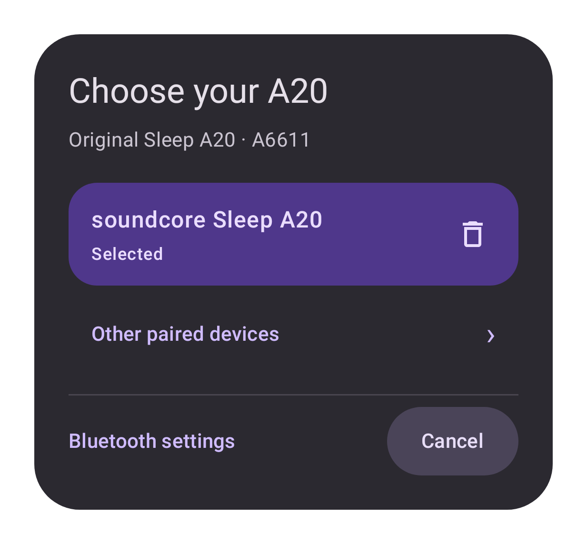

# Device picker

Native Compose rendering on API35 Robolectric, 411dp-wide window at xxhdpi,
Material 3 dark colors and synthetic device data. Colors follow the phone’s theme
in the app. This is a layout preview, not physical Samsung acceptance.

The selected name and status share a left edge. Its delete button stays inside
the same rounded row with a 48dp touch target. Other choices use the same content
inset. Bluetooth settings stays left-aligned; Cancel sits at the right of a
separate footer. The device list scrolls within the available dialog height.
