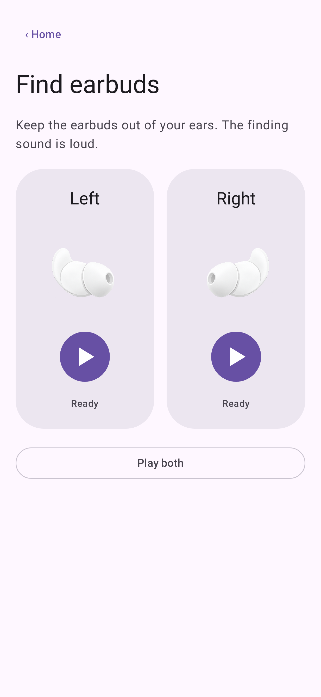
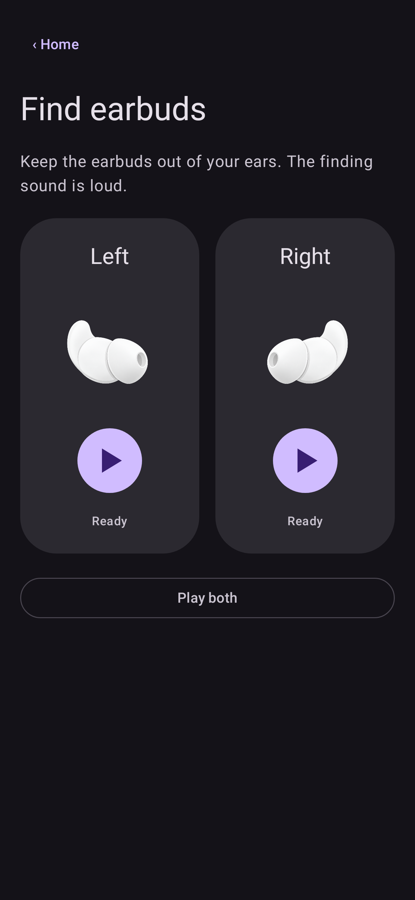

# Find earbuds layout

Native Compose previews of Companion 0.4.6, API35, 411dp wide, synthetic connected
A6611 data and Material 3 light/dark colors. The actual app follows the phone's
dynamic palette. These images demonstrate layout, not Bluetooth hardware tests.

| Light | Dark |
| --- | --- |
|  |  |

Matching left/right cards use a large Play button; active cards change color and
shape and show a Stop icon. Play both sits below. Stop cancels both, and Stop all
remains explicit during an active or uncertain session. The page scrolls on short
screens and with larger fonts. The loud-sound dialog uses Play sound/Cancel,
without a checkbox. Confirmation is remembered separately for each ear until
leaving the page or backgrounding. See [behavior](../../docs/FIND_EARBUDS.md).

The 0.4.6 layout removes the small notes below the controls; a disconnected
device retains its connection prompt. The warning remains in the confirmation.
