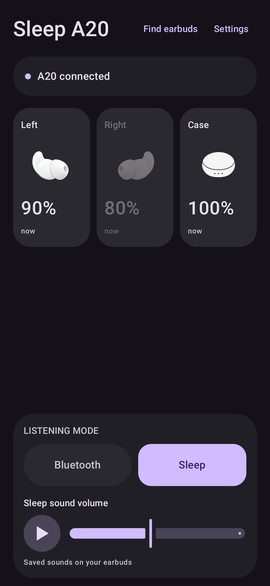
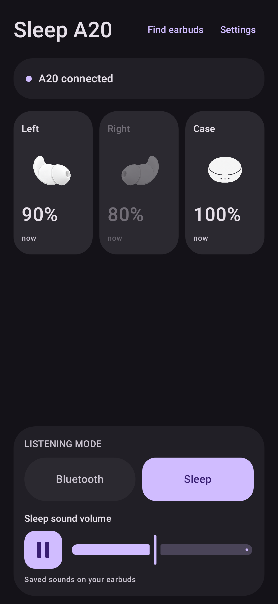
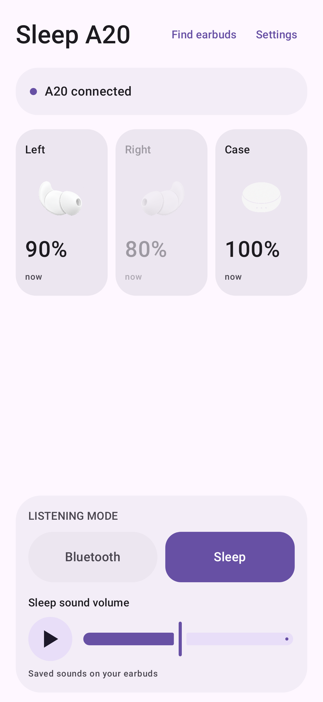
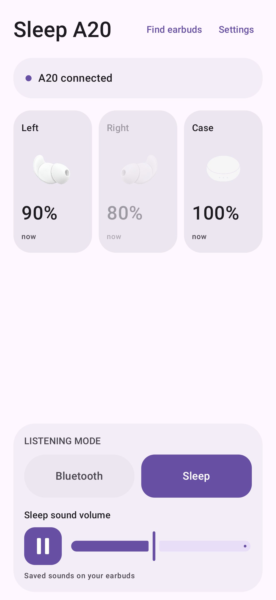

# Home playback control — 0.4.7

| | Paused: tap to play | Playing: tap to pause |
| --- | --- | --- |
| Dark |  |  |
| Light |  |  |

Native Compose rendering on API35 at411dp wide, synthetic single-ear A6611 Sleep
state. The disconnected peer retains its battery reading and is dimmed. These are
actual app layout previews, not images generated to approximate the UI. The app
uses the phone's dynamic color palette.

The icon button is on the **left of the volume slider**, with matching vertical
centers. Its 56dp footprint and the slider position stay fixed. While playing,
only two pause bars appear in a soft square. While paused, only a triangle appears
in a circle. Material 3 Expressive motion animates the shape change; static images
show the end states. Bluetooth uses the same layout.
[State sources and behavior](../../docs/PLAYBACK.md).
